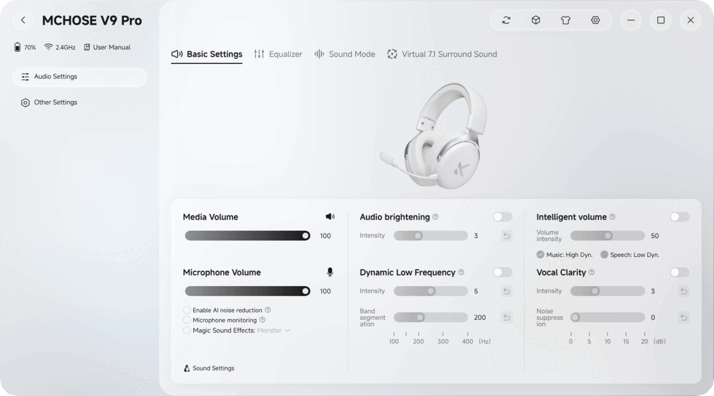
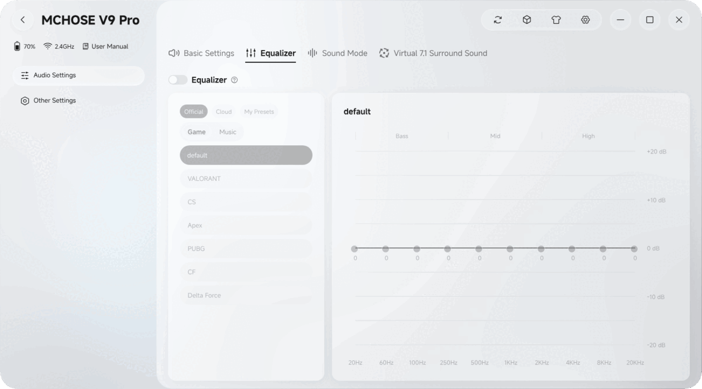
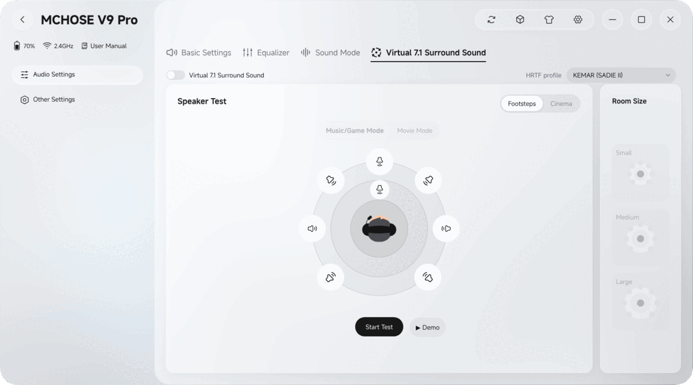

# V9 Linux Hub

**Unofficial** Linux app for the **MCHOSE V9 Pro** wireless headset. It runs natively, without Wine: the
manufacturer's interface on top of a PipeWire sound engine, so the headset's software features work on Linux.

[Русская версия](README.ru.md)

| Settings | Equalizer | Virtual 7.1 |
|---|---|---|
|  |  |  |

> This project is not affiliated with, endorsed by, or supported by MCHOSE or C-Media.
> "MCHOSE" and "V9 Pro" are used only to say which hardware the app is for.

## What works

| Feature | How |
|---|---|
| Sound mode (Game 1 / Game 2 / Music), battery, firmware info | WebHID to the USB receiver |
| Volume, mute | PipeWire |
| 10-band EQ and presets, Audio brightening, Dynamic low frequency, Intelligent volume | PipeWire filter-chain on a virtual output device. Parameters are fitted to measurements of the Windows driver |
| Virtual 7.1 surround (Music/Game and Movie modes, three room sizes) | Open HRTF datasets (see below) plus a room model of our own |
| AI noise reduction, Vocal clarity, Magic voice, mic monitoring | PipeWire filter-chain on a virtual microphone: RNNoise, LSP plugins, and a voice plugin of our own (`native/v9_voice.c`) |
| 7.1 speaker test | Our own synthesized sounds: footsteps around you, or a short movie scene |

Not available: the MCHOSE account, cloud presets, firmware updates (OTA), and features for other MCHOSE devices.

## Install

```bash
git clone https://github.com/maleon17/v9-linux-hub.git && cd v9-linux-hub
./install.sh
```

The installer:

1. checks the dependencies;
2. builds the voice plugin;
3. adds a udev rule so the receiver is accessible without root (this asks for `sudo`);
4. adds a menu entry.

You need:

- Electron ≥ 30;
- PipeWire ≥ 1.0 with `pactl`;
- libmysofa;
- LSP Plugins (LV2);
- a C compiler;
- optionally noise-suppression-for-voice (RNNoise), for AI noise reduction.

Run it from the menu (**V9 Linux Hub**) or with `./v9hub`. `./v9hub --hidden` starts it in the tray.

Closing the window hides the app to the tray, and sound processing keeps running. Quit from the tray menu. While the app
runs, the virtual devices **V9 Pro 7.1 Surround** and **V9 Pro Microphone** are the defaults. On exit, the previous
defaults come back.

## Virtual 7.1 and HRTF profiles

The surround effect convolves each of the eight channels with a pair of head-related impulse responses (HRIRs). It adds
early reflections from a simple room model and a diffuse tail. The HRIRs come from open datasets. Pick one under
**HRTF profile** on the 7.1 page:

| Profile | Source | License |
|---|---|---|
| KEMAR (SADIE II) — default | University of York, [SADIE II](https://www.york.ac.uk/sadie-project/database.html) | Apache-2.0 |
| KU100 (SADIE II); five people chosen to differ the most: H7 (typical), H19, H14, H5, H9 | same | Apache-2.0 |

SADIE II files are downloaded from [sofacoustics.org](https://sofacoustics.org/data/database/sadie/) the first time you
select them, into `~/.cache/v9-linux-hub/sofa`.

Profiles you have not picked yet are prepared in the background when you open the 7.1 page (about 120 MB in total, once), so switching is instant. HRTFs are personal: one dataset can sound precise to one person and "inside the head" to another, so try several.
Your own SOFA files also work: put any `*.sofa` into `~/.config/v9-linux-hub/hrtf/user/` and it appears in the list.

A ready-made HRIR pack can go in the same folder, as a subfolder of `m{mode}_r{room}_ch{0..7}.wav` stereo files
(channels FL FR FC LFE RL RR SL SR).

## Network access

| When | Host | What |
|---|---|---|
| First start | `cdn.mchose.com.cn` | The manufacturer's web interface (≈45 MB, version 1.1.26), pinned by `frontend/manifest.json` (paths and SHA-256), cached in `~/.config/v9-linux-hub/frontend` |
| While running | `cdn.mchose.com.cn`, `www.mchose.com.cn`, `www.maicong.cn`, `chat.maicong.cn` | Requests the manufacturer's interface makes itself (configuration, images, community and support pages), the same as on Windows |
| When you pick a SADIE II profile | `sofacoustics.org` | The HRTF dataset (12–37 MB) |

The app itself sends nothing else. It does not log in to any account.

## How it works

- `main.cjs` is the Electron main process. It implements the interface's IPC contract on Linux: stores, windows, audio
  devices, and the audio SDK calls.
- `lib/preload.cjs` is the bridge to the page. It also pads HID reports to the descriptor length, as the Windows HID stack
  does.
- `lib/dsp.cjs` is the sound engine: two `pipewire -c` filter-chain processes, with live parameter changes through
  `pw-cli`.
- `lib/hrtf.cjs` builds HRIR packs from SOFA files.
- `lib/testsig.cjs` makes the test sounds.
- `lib/ui-linux.*` adapts the interface to Linux: window resizing and the 7.1 page controls.
- `dsp/params.json` holds the fitted parameters of the effects. The fitting scripts are in `tools/`.

## Uninstall

```bash
./install.sh --uninstall
rm -rf ~/.config/v9-linux-hub ~/.cache/v9-linux-hub
```

## License

GPL-3.0-or-later. See [LICENSE](LICENSE). This applies to the code in this repository only. The manufacturer's
interface, which the app downloads at first start, is not part of this project and is not covered by this license.
