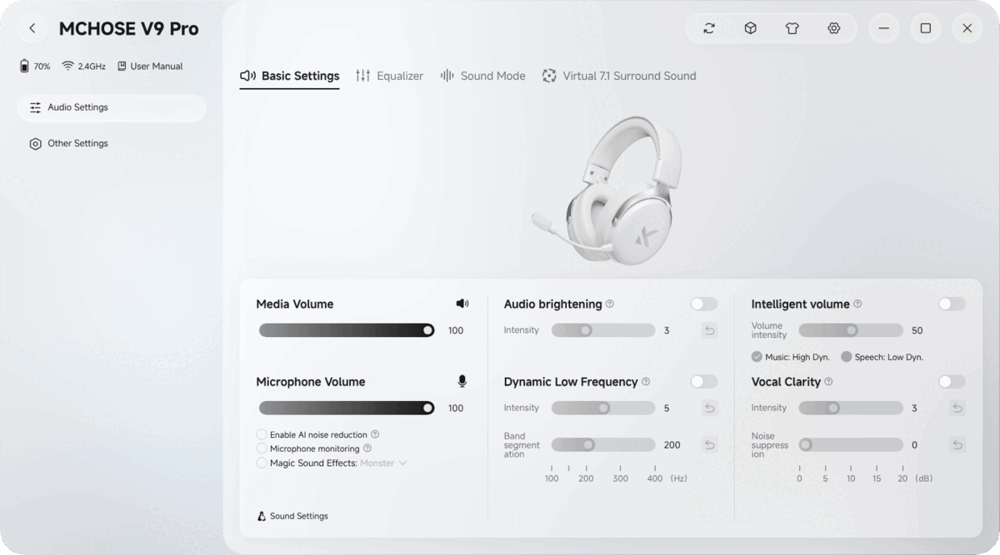
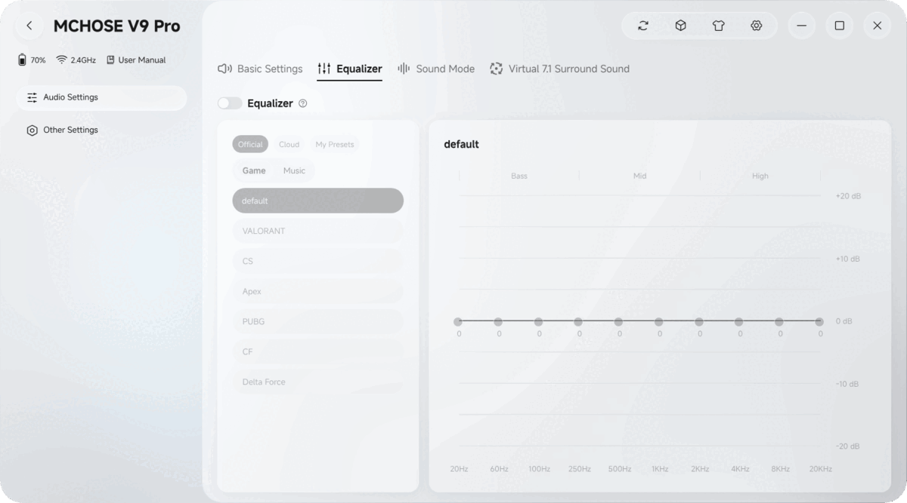
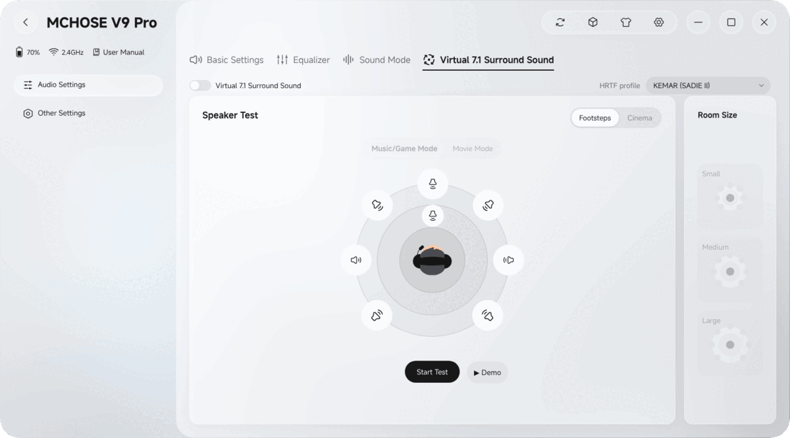

# V9 Linux Hub

**Неофициальное** приложение для беспроводной гарнитуры **MCHOSE V9 Pro** на Linux, без Wine. Это интерфейс
производителя поверх звукового движка на PipeWire: программные функции гарнитуры работают и в Linux.

> Проект не связан с MCHOSE и C-Media, они его не одобряли и не поддерживают. Названия «MCHOSE» и «V9 Pro»
> используются только чтобы указать, для какого устройства приложение.

| Настройки | Эквалайзер | Виртуальный 7.1 |
|---|---|---|
|  |  |  |

## Что работает

| Функция | Как сделано |
|---|---|
| Режим звука (Игра 1 / Игра 2 / Музыка), заряд, версия прошивки | WebHID к USB-ресиверу |
| Громкость, mute | PipeWire |
| 10-полосный эквалайзер с пресетами, «Яркость звука», «Динамические низкие частоты», «Умная громкость» | Filter-chain PipeWire на виртуальном устройстве вывода. Параметры подогнаны под измерения Windows-драйвера |
| Виртуальный 7.1 (режимы «Музыка/игры» и «Кино», три размера комнаты) | Открытые наборы HRTF (см. ниже) и своя модель комнаты |
| AI-шумоподавление, «Чистота голоса», «Волшебный голос», прослушивание микрофона | Filter-chain на виртуальном микрофоне: RNNoise, LSP и свой плагин голоса (`native/v9_voice.c`) |
| Проверка колонок 7.1 | Свои синтезированные звуки: шаги вокруг или короткая киносцена |

Нет: аккаунта MCHOSE, облачных пресетов, обновления прошивки (OTA) и функций других устройств MCHOSE.

## Установка

```bash
git clone https://github.com/maleon17/v9-linux-hub.git && cd v9-linux-hub
./install.sh
```

Установщик:

1. проверяет зависимости;
2. собирает плагин голоса;
3. добавляет правило udev, чтобы ресивер был доступен без root (попросит `sudo`);
4. создаёт ярлык в меню.

Нужны:

- Electron ≥ 30;
- PipeWire ≥ 1.0 с `pactl`;
- libmysofa;
- LSP Plugins (LV2);
- компилятор C;
- по желанию noise-suppression-for-voice (RNNoise) для AI-шумоподавления.

Запуск: из меню («V9 Linux Hub») или `./v9hub`. `./v9hub --hidden` запускает сразу в трей.

Закрытие окна сворачивает приложение в трей, обработка звука продолжает работать. Полный выход — через меню трея. Пока
приложение работает, устройствами по умолчанию становятся виртуальные **V9 Pro 7.1 Surround** и **V9 Pro Microphone**.
При выходе прежние устройства возвращаются.

## Виртуальный 7.1 и профили HRTF

Каждый из восьми каналов сворачивается с парой импульсных характеристик головы (HRIR). К этому добавляются ранние
отражения простой модели комнаты и диффузный хвост. HRIR берутся из открытых наборов. Профиль выбирается на странице 7.1
в поле **«Профиль HRTF»**:

| Профиль | Источник | Лицензия |
|---|---|---|
| KEMAR (SADIE II) — по умолчанию | University of York, [SADIE II](https://www.york.ac.uk/sadie-project/database.html) | Apache-2.0 |
| KU100 (SADIE II); пятеро самых непохожих людей: H7 (типичный), H19, H14, H5, H9 | там же | Apache-2.0 |

Файлы SADIE II скачиваются с [sofacoustics.org](https://sofacoustics.org/data/database/sadie/) при первом выборе профиля,
в `~/.cache/v9-linux-hub/sofa`.

Остальные профили списка готовятся фоном при открытии страницы 7.1 (один раз, всего около 120 МБ), поэтому переключение мгновенное. HRTF индивидуальны: один набор кому-то даёт точные направления, а у другого звук остаётся «в голове», поэтому стоит
попробовать несколько. Можно подключить свой SOFA-файл: положите `*.sofa` в `~/.config/v9-linux-hub/hrtf/user/`, и он
появится в списке.

Туда же можно положить готовый HRIR-пакет: подпапку со стерео-файлами `m{режим}_r{комната}_ch{0..7}.wav`
(каналы FL FR FC LFE RL RR SL SR).

## Сеть

| Когда | Адрес | Что |
|---|---|---|
| Первый запуск | `cdn.mchose.com.cn` | Веб-интерфейс производителя (≈45 МБ, версия 1.1.26). Версия закреплена в `frontend/manifest.json` (пути и SHA-256), кеш в `~/.config/v9-linux-hub/frontend` |
| Во время работы | `cdn.mchose.com.cn`, `www.mchose.com.cn`, `www.maicong.cn`, `chat.maicong.cn` | Запросы самого интерфейса производителя (конфигурация, картинки, страницы сообщества и поддержки), как и в Windows |
| При выборе профиля SADIE II | `sofacoustics.org` | Набор HRTF (12–37 МБ) |

Само приложение больше ничего не отправляет и ни в какой аккаунт не входит.

## Устройство

- `main.cjs` — main-процесс Electron. Реализует IPC-контракт интерфейса в Linux: хранилища, окна, аудиоустройства и
  вызовы аудио-SDK.
- `lib/preload.cjs` — мост к странице. Ещё он дополняет HID-отчёты до длины из дескриптора, как это делает HID-стек
  Windows.
- `lib/dsp.cjs` — звуковой движок: два процесса `pipewire -c` с filter-chain, параметры меняются на лету через `pw-cli`.
- `lib/hrtf.cjs` — сборка HRIR-пакетов из SOFA.
- `lib/testsig.cjs` — тестовые звуки.
- `lib/ui-linux.*` — адаптация интерфейса под Linux: изменение размера окна и элементы на странице 7.1.
- `dsp/params.json` — подогнанные параметры эффектов. Скрипты подгонки лежат в `tools/`.

## Удаление

```bash
./install.sh --uninstall
rm -rf ~/.config/v9-linux-hub ~/.cache/v9-linux-hub
```

## Лицензия

GPL-3.0-or-later, см. [LICENSE](LICENSE). Лицензия распространяется только на код этого репозитория. Интерфейс
производителя, который приложение скачивает при первом запуске, не входит в проект и под эту лицензию не подпадает.
